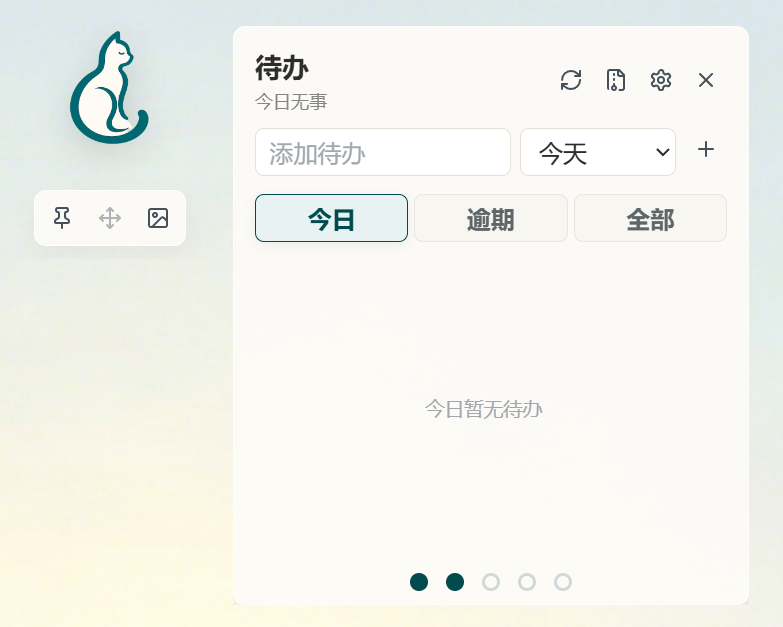
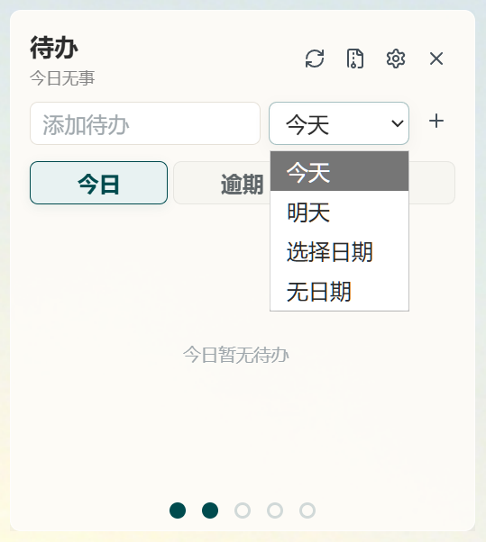
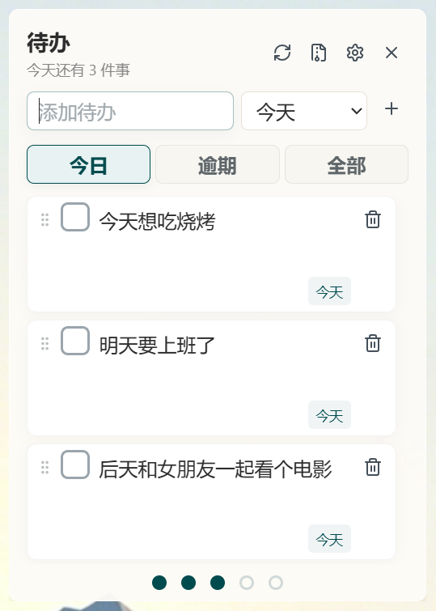
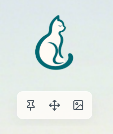
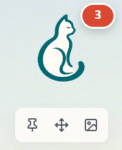
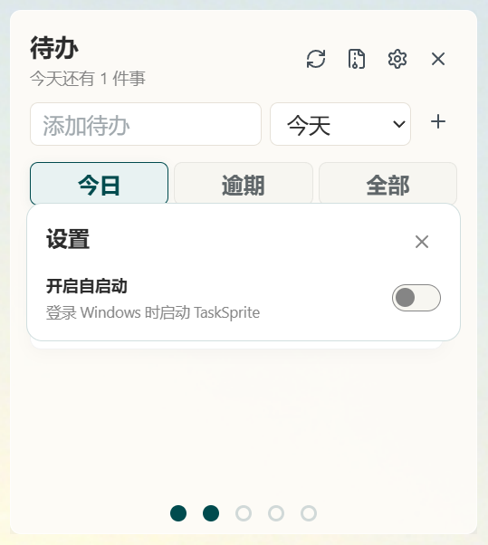
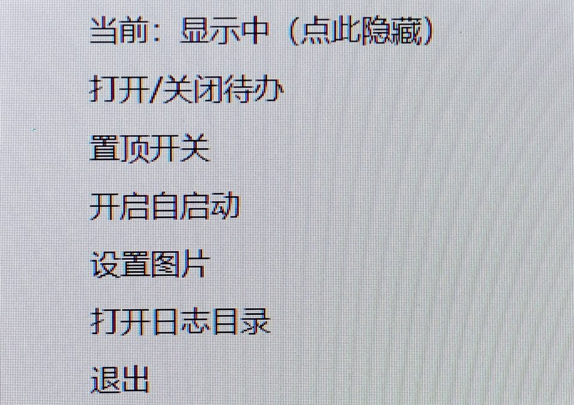

# TaskSprite/待办组件

TaskSprite 是一款 Windows 桌面待办工具。点击桌宠即可打开待办面板，随手记下今天要做的事。待办、设置和自定义桌宠图片保存在本机，无需注册账号。

**[下载 Windows x64 安装包（1.0.0）](https://github.com/fang-123559/TaskSprite/releases/download/v1.0.0/TaskSprite_1.0.0_x64-setup.exe)** · [查看最新版与更新记录](https://github.com/fang-123559/TaskSprite/releases/latest)

<p>
  
</p>

## 主要功能

### 打开待办面板

点击桌宠打开待办面板。可以切换「今日」「逾期」「全部」，分别查看今天的待办、尚未完成的逾期待办和全部待办。

<p>
  
</p>

### 添加和整理待办

输入事项后，可以选「今天」「明天」「选择日期」或「无日期」，再点加号。已有待办可以编辑标题、勾选完成、拖动左侧手柄排序，或点右侧的垃圾桶删除。

<p>
  
  
</p>

### 调整桌宠与查看待办数

桌宠下方的三个按钮用于置顶、拖动位置和更换图片，支持 PNG、JPEG 和 WebP。右上角的数字表示今日尚未完成的待办数。

<p>
  
  
</p>

### 登录 Windows 时自启动

点击待办面板右上角的齿轮，在「设置」里切换「开启自启动」。默认关闭。开启后，TaskSprite 会在当前用户登录 Windows 时启动。也可以通过系统托盘切换。

<p>
  
</p>

### 从系统托盘操作

右键点击 TaskSprite 托盘图标，可以显示或隐藏桌宠、打开或关闭待办面板、切换置顶和自启动、设置图片、打开日志目录，或完全退出应用。菜单项前有勾表示对应开关已开启。

<p>
  
</p>

## 安装与更新

1. 从上方链接下载 `.exe` 安装包。已有旧版时，先从系统托盘退出 TaskSprite。
2. 双击安装包并按提示完成安装。打开 TaskSprite 后，点击桌宠即可添加待办。
3. 以后可以从待办面板手动检查更新。应用内更新会验证 Tauri updater 签名。

<details>
<summary>核对安装包 SHA-256</summary>

下载同一版本的 [SHA256SUMS.txt](https://github.com/fang-123559/TaskSprite/releases/download/v1.0.0/SHA256SUMS.txt)，在安装包所在文件夹打开 PowerShell，运行：

```powershell
Get-FileHash -Algorithm SHA256 -LiteralPath '.\TaskSprite_1.0.0_x64-setup.exe'
```

将输出的 `Hash` 与清单里的安装包记录核对。1.0.0 安装包没有 Authenticode 签名，Windows 可能显示「未知发布者」或 SmartScreen 提示。

</details>

## 隐私与许可

查看[隐私说明](./PRIVACY.md)。第三方许可证与归属说明随安装包提供，可在安装目录中查看。
